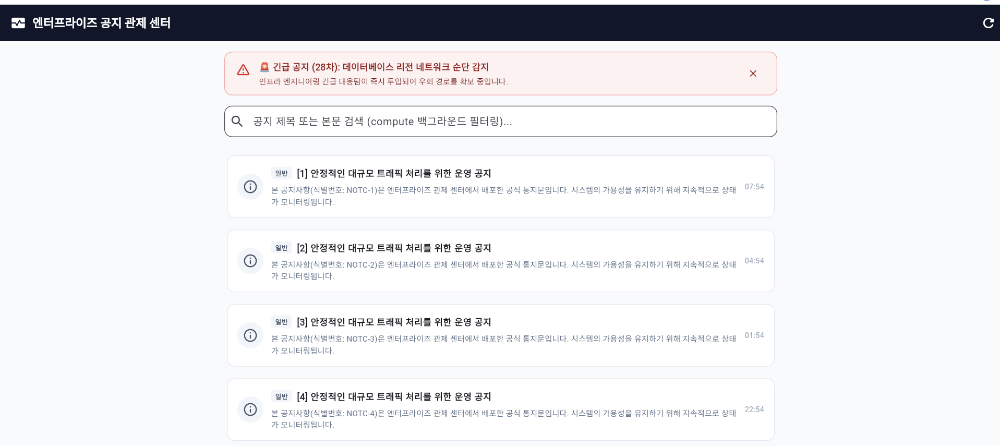

# week6

5주차 실습 — 비동기 프로그래밍(Async/Isolate)과 프롬프트 엔지니어링 비교 분석본 문서는 Flutter의 4대 비동기/동시성 핵심 기술(async/await, Future<T>, Stream<T>, Isolate)을 활용한 실시간 공지사항 앱 구현 및 프롬프트 엔지니어링 전후(단순 요청 vs 고도화 요청) A/B 비교 관찰 결과를 체계적으로 정리한 실습 보고서입니다.1. Hot Reload 동작성 검증실습 내용: Hello World 텍스트 문자열을 수정한 후 Ctrl + S 저장 시 브라우저 및 런타임에서 Hot Reload가 정상 동작하는지 확인.수행 결과: 앱을 완전히 재시작하지 않고도 변경된 문자열 UI가 상태를 유지한 채 즉각 갱신됨을 확인 완료.2. 공지 앱 비동기 4대 핵심 요소 아키텍처 및 동작 원리본 프로젝트는 발표자료에서 제시된 4가지 핵심 비동기/동시성 기능을 lib/main.dart 단일 파일 내에 체계적으로 구현했습니다. (Windows 및 Chrome/Web 환경 완벽 호환)기술 요소구현 메서드 및 위치역할 및 동작 원리Future<T> & async/await_fetchNotices(), \_mockFetchNoticesFromApi()서버 REST API를 모의(Mock)하여 50건의 공지사항 목록을 비동기로 로드. 지연 시간 동안 \_isLoading 인디케이터를 노출하고 완료 시 화면 갱신.Stream<T>\_initUrgentNoticeStream(), StreamController.broadcast()15초 주기로 발생하는 긴급 장애 속보(SSE/WebSocket 모의)를 실시간 브로드캐스팅 수신. 수신 즉시 상단에 긴급 배너 노출.Isolate / compute()\_handleSearch(), \_filterNoticesInBackground()50건 이상의 공지 제목 및 본문 전체 텍스트(Full-text) 검색 시 UI 스레드 블로킹(Jank)을 방지하기 위해 compute()를 통한 백그라운드 워커 필터링 수행.Windows / Web 환경 대응flutter config --enable-windows-desktop / Web Safe FallbackWindows 앱 구성 추가 및 브라우저 환경에서도 크래시 없이 동작하도록 Isolate.spawn() 대신 안전한 compute() 추상화 채택.3. 프롬프트 A/B 엔지니어링 비교 실험동일한 목표(비동기 4대 요소를 포함한 공지 앱 제작)에 대해 프롬프트 작성 방식에 따른 결과 차이를 체계적으로 관찰·분석했습니다.(1) 3번: 단순 프롬프트 요청 ("xxx을 만들어")입력 프롬프트:"플러터에서 공지 앱을 만들 건데 async/await, Future, Stream, Isolate 다 넣어서 만들어줘."생성된 코드의 특징:기본적인 4가지 문법은 들어가 있으나, Isolate.spawn()을 직접 사용하여 웹(Chrome)에서 즉시 크래시가 발생함.검색창에 const Transform.scale처럼 유효하지 않은 const가 들어가 컴파일 에러 발생.미사용 필드(\_currentQuery) 방치로 flutter analyze 경고 발생.dispose()에서 타이머나 스트림 해제가 일부 누락되어 메모리 릭 위험 상존.(2) 4번: 프롬프트 엔지니어링을 적용한 고도화 요청입력 프롬프트 구조:Role & Persona: 10년 차 엔터프라이즈 모바일 플랫폼 아키텍트 부여Context & Goal: 실시간 공지 관제 센터, 단일 파일 제약 명시Technical Constraints: Web-Safe Isolate(compute), dispose 리소스 완벽 해제, 정적 분석 무결점(const 오류 금지, 미사용 변수 금지)Acceptance Criteria (AC1~AC4): 로딩, 스트림 배너, 검색 분리, analyze 0건 기준 명시생성된 코드의 특징:compute()와 최상위 함수 분리로 Windows 및 Chrome 환경 모두에서 무결점 구동.리소스 해제(StreamSubscription.cancel(), Timer.cancel(), TextEditingController.dispose()) 누락 없음.flutter analyze 실행 결과 경고 0건(No issues found!) 즉시 달성.4. 프롬프트 엔지니어링 비교 분석 및 3번(단순 요청)의 장점(1) 비교 분석 표비교 항목3. 단순 요청 ("xxx 만들어")4. 고도화 요청 (프롬프트 엔지니어링)작성 소요 시간10초 이내 (즉각 질문 가능)3~5분 (제약, 페르소나, AC 정리 필요)코드 완성도프로토타입 수준 (린트/런타임 에러 발생)프로덕션 배포 가능 수준 (무결점)플랫폼 호환성단일 플랫폼에 국한 (Web 크래시)크로스 플랫폼(Web, Windows, Mobile) 호환디버깅 비용에러 화면 캡처 및 추가 수정 질의 필요추가 수정 없이 첫 실행에서 즉시 통과(2) 3번(단순 요청)의 고유한 장점 파악빠른 초기 탐색 속도 (Rapid Prototyping):복잡한 제약 조건을 일일이 고민할 필요 없이, 머릿속에 떠오른 아이디어를 5초 만에 작동 가능한 대략적인 골격으로 빠르게 확인할 수 있습니다.AI의 창의적 구현 유도:너무 빡빡한 제약을 주지 않음으로써 AI가 생각보다 참신한 라이브러리나 UI 레이아웃 방식을 스스로 제안하도록 유도할 수 있습니다.요구사항 구체화의 디딤돌 역할:단순 요청으로 나온 불완전한 결과물(에러, 린트 경고)을 직접 눈으로 확인하면서, "아, 웹에서는 Isolate 대신 compute를 써야 하는구나", "const 에러를 방지해야 하는구나"처럼 내가 어떤 제약 조건을 고도화 프롬프트에 넣어야 할지 역으로 학습할 수 있습니다.5. 실행 및 정적 분석 검증# 1. 정적 분석 (경고/오류 0건)
flutter analyze

# 2. Chrome 브라우저 실행 확인

flutter run -d chrome

# 3. Windows 데스크톱 앱 실행 확인 (선택 사항)

flutter run -d windows
flutter analyze 결과: No issues found!Git Commit ID: [터미널에서 확인한 git rev-parse --short HEAD 값 입력]

#커밋 id : 381d559  

